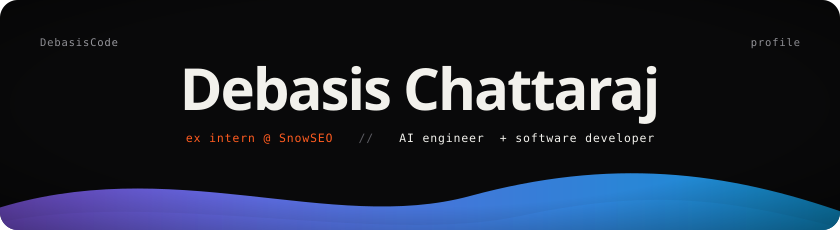

<!--

  Debasis Chattaraj's profile README. Notes for the next person who edits this:

  - The four visuals (hero.svg, footer.svg, activity.svg, cp.svg) are generated
    inside this repo, not by third-party stat services. They are built by
    scripts/live/ with zero dependencies and rebuilt daily by
    .github/workflows/live-cards.yml. Self-hosted cards never rate limit and
    never randomly go dark. To preview locally: node scripts/live/build.mjs
    (it falls back to a public contributions API when GITHUB_TOKEN is absent).
  - GitHub strips JavaScript from READMEs, so nothing can react to actual
    scrolling; every animation here is CSS or SMIL inside SVG , which
    GitHub does allow.
  - The only external widgets kept are the ones known to render reliably
    (github-profile-summary-cards, streak-stats, leetcard, badges).
  - Page color theme: violet #8b5cf6 into sky #0ea5e9; the live cards carry
    their own dark panel + orange accent family.

-->

  
  
  

---

## About

Most of what I build is the unglamorous middle layer of software: queues, integrations and AI plumbing that does real work while nobody babysits it.

Concretely: I help businesses **automate, integrate and create workflows, and adopt AI to increase the speed of their work**. That was literally the job at **SnowSEO**, where I recently wrapped my SDE internship: AI automation, platform integrations and analytics pipelines, shipped to production. Before that, competitive programming bent how my brain works, and it still shows up in how I design systems.

- **Ex SDE intern @ SnowSEO.** AI automation, integrations and analytics, running in production
- **Information Technology** student at [GGSIPU](http://www.ipu.ac.in/)
- **Knight on LeetCode, Pupil on Codeforces**, still contesting on CodeChef
- **Winner, Smart Delhi Ideathon**
- Open to **internships and full-time roles** in AI engineering and software development. [My resume](https://drive.google.com/file/d/1cudQzuAQi7d6S3ldLEuKeWP6hN_Iwmar/view?usp=sharing) has the formal version.

 

**[View my resume](https://drive.google.com/file/d/1cudQzuAQi7d6S3ldLEuKeWP6hN_Iwmar/view?usp=sharing)** · **[Email me](mailto:flancer250@gmail.com)** · **[LinkedIn](https://www.linkedin.com/in/debasis-chattaraj-4370ba220/)**

## Live from my GitHub

<!--
  Generated inside this repo and committed by GitHub Actions, so the README
  never depends on a rate-limited third-party service: assets/live/hero.svg,
  assets/live/activity.svg, assets/live/cp.svg and assets/live/footer.svg all
  come from scripts/live/ + live-cards.yml.
  Preview locally with: node scripts/live/build.mjs
-->

## What I work with

**Languages**

**Frontend**

**Backend & databases**

**Tools**

**AI & automation plumbing**

## Featured Projects

### Outreach: a keyboard-first AI job-search agent

Outreach is a job-search agent you talk to in chat, built in the spirit of Claude Code. Ask it for roles and it finds them, then finds the recruiter or hiring manager behind them, digs up their work email, and drafts a short personal message from your own Gmail. Nothing sends until you click Send. The same agent fills job applications for you: it drives a real Chrome window on your machine, reads the application form field by field, fills in what it knows from your profile and resume, and shows you a screenshot of the finished form before you decide whether to submit.

**What makes it interesting:** it reads forms by labels and ARIA roles instead of CSS classes, so it keeps working when job sites redesign, and every send or submit is approval-gated. The machine does the typing, you stay in charge.

### ShipOne: ship a full-stack app with one command

ShipOne is a free, open source npm CLI built on one complaint: the last hour of every project was the same 30 to 60 minutes of deploy dashboard clicking. Run `shipone` and it figures out which folder is your website and which is your server, deploys the frontend to Vercel or Netlify and the backend to Render or Railway, all inside your own accounts so there is no vendor lock-in and no markup. Before anything goes live it wires the two halves to each other, API addresses exchanged both ways and browser security sorted out, and if a build fails it points at the exact lines that broke. Run it again and it finds the same project instead of creating a duplicate.

**What makes it interesting:** the frontend/backend wiring is the part every deploy tool leaves as homework. ShipOne handles it, warns about hardcoded localhost URLs and forgotten secrets before launch, and keeps a tiny `shipone.yml` in your repo so your whole team gets the same one-command deploy.

 

<table>
<tr>
<td width="50%" valign="top">

### AI Lecture Notes Generator

A real-time web app that records lectures, converts speech to text and lets an LLM write concise, context-aware notes, filtering out the irrelevant chatter. A Node.js pipeline streams audio to a transcription API and feeds the text to a model for summarisation.

</td>
<td width="50%" valign="top">

### Interactive C++ Code Visualizer

An educational tool that teaches C++ by visualising execution: step-by-step dry runs, live variable state and a dynamic function call stack. A React + D3.js front end renders recursion and function lifecycles interactively, so hard concepts finally click.

</td>
</tr>
</table>

### Personalized Jarvis Assistant

A Python voice assistant built with SpeechRecognition, pyttsx3, FastAPI and spaCy/NLTK that executes natural-language commands. Modular command architecture: system control, web automation, task scheduling and plug-in commands.

&nbsp;

<b>More things I've built</b>

 

## GitHub Stats

<!--
  Kept: github-profile-summary-cards and streak-stats, both render reliably.
  Deliberately not used: github-readme-stats.vercel.app, github-readme-activity-graph
  and github-profile-trophy, their shared public instances get rate limited hard
  enough that the images regularly fail to load. If you want them back, self-host
  first: https://github.com/anuraghazra/github-readme-stats#deploy-on-your-own-vercel-instance
-->

<picture>
  <source srcset="https://github-profile-summary-cards.vercel.app/api/cards/profile-details?username=DebasisCode&theme=github_dark" media="(prefers-color-scheme: dark)" />
  
</picture>

<picture>
  <source srcset="https://github-profile-summary-cards.vercel.app/api/cards/repos-per-language?username=DebasisCode&theme=github_dark" media="(prefers-color-scheme: dark)" />
  
</picture>
<picture>
  <source srcset="https://github-profile-summary-cards.vercel.app/api/cards/most-commit-language?username=DebasisCode&theme=github_dark" media="(prefers-color-scheme: dark)" />
  
</picture>

<picture>
  <source srcset="https://github-profile-summary-cards.vercel.app/api/cards/stats?username=DebasisCode&theme=github_dark" media="(prefers-color-scheme: dark)" />
  
</picture>
<picture>
  <source srcset="https://streak-stats.demolab.com?user=DebasisCode&hide_border=true&theme=tokyonight" media="(prefers-color-scheme: dark)" />
  
</picture>

## Competitive Programming

  

  

**Codeforces, live from the Codeforces API**

  

**LeetCode**

<picture>
  <source srcset="https://leetcard.jacoblin.cool/Debasis6969?theme=dark&font=Inter&ext=heatmap" media="(prefers-color-scheme: dark)" />
  
</picture>

## Connect With Me

---

  Thanks for reading this far. If some part of it reads like a problem your team has right now, you know where to find me.
    
  

